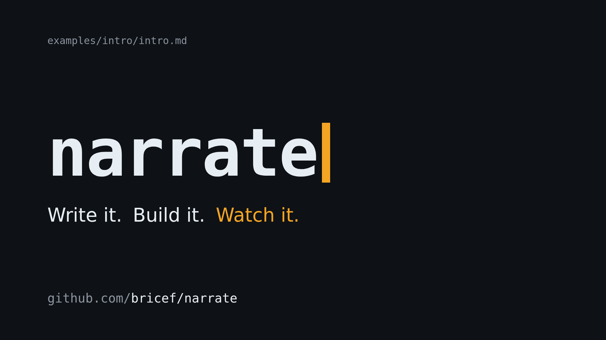

# narrate

<p align="center">
  <a href="https://youtu.be/NyzvmIZcxBs" rel="nofollow">
    
  </a>
</p>


narrate turns a Markdown script and a folder of pictures and clips into a
narrated video, on your own computer. You write the scenes and the words; it
generates the voice-over, lays out the pictures, slides and subtitles, and
times every scene to its narration.

It reads the script format of Narakeet's "Markdown to Video" service, so
Narakeet projects build unchanged, without uploading anything. narrate isn't
affiliated with or endorsed by Narakeet.

- **Speech:** Kokoro, free and running on your computer, or ElevenLabs with
  your own account.
- **Visuals:** pictures with pan and zoom, video clips, text and code slides,
  themes, callouts and 24 kinds of transition.
- **Generated pictures:** Mermaid diagrams, captures of live web pages and
  placeholder cards, written as code blocks in the script (a narrate
  extension).
- **Animated HTML scenes:** web pages animated with CSS or JavaScript, captured
  frame by frame so every build is identical (a narrate extension).
- **Overlays:** transparent web pages laid over a scene or the whole video,
  such as a ticker, a lower third or a legend, on the video's own clock (a
  narrate extension).
- **Sound and text:** recorded audio, background music, and subtitles, burned
  in or as files.
- **Ways to run it:** a command line, a web studio for writing scripts
  (`narrate studio script.md`), an HTTP API for your own programs
  (`narrate serve`), a Docker image and a GitHub Action.

## Install

### With Docker

Docker is the only requirement. The image holds narrate, ffmpeg, Chromium and
fonts:

```sh
docker pull ghcr.io/bricef/narrate
```

It runs natively on Intel and AMD processors and on Macs with Apple chips.

### With uv

[uv](https://docs.astral.sh/uv/getting-started/installation/) installs the
`narrate` command without a checkout. On Linux (tested on Ubuntu 24.04 and
Debian 13):

```sh
uv tool install --python 3.12 --with-executables-from playwright \
    git+https://github.com/bricef/narrate@v0.1.1 # narrate, and Playwright's command
playwright install --with-deps chromium          # headless Chromium; asks for sudo for its libraries
sudo apt-get install -y fonts-dejavu-core        # the subtitle font
narrate doctor                                   # checks the setup
```

On macOS, with [Homebrew](https://brew.sh/) installed:

```sh
brew install uv ffmpeg-full                      # uv, and ffmpeg with subtitles and pitch
brew install --cask font-dejavu                  # the subtitle font
uv tool install --python 3.12 --with-executables-from playwright \
    git+https://github.com/bricef/narrate@v0.1.1 # narrate, and Playwright's command
playwright install chromium                      # headless Chromium
narrate doctor                                   # checks the setup
```

- **Python 3.12** is the version narrate is tested with. Without
  `--python 3.12`, uv may choose a newer one that some of narrate's packages
  don't support yet.
- **Chromium:** `--with-executables-from playwright` installs Playwright's
  command too, which downloads the headless Chromium narrate uses. Without
  sudo, see [Troubleshoot](docs/building.md#troubleshoot) for its libraries.
- **ffmpeg:** on Linux, narrate downloads its own on the first build. On
  macOS it uses Homebrew's `ffmpeg-full`, as the plain `ffmpeg` lacks the
  subtitle and pitch filters narrate needs.
- **The Kokoro voice model** downloads on the first build.
- **Commands:** uv puts them in `~/.local/bin`. If your shell can't find
  them, `uv tool update-shell` adds that folder to your `PATH`.
- **Package versions:** uv installs the newest releases of the Python
  packages narrate depends on, not the exact versions narrate is tested
  with. If something doesn't work, try a checkout (below), which installs
  those.

### From source

A checkout is for working on narrate, or for running the exact package
versions its tests use. On Linux (tested on Ubuntu 24.04 and Debian 13), with
[uv](https://docs.astral.sh/uv/getting-started/installation/) installed:

```sh
git clone https://github.com/bricef/narrate.git
cd narrate
uv sync                                          # Python 3.12 and narrate's packages
uv run playwright install --with-deps chromium   # headless Chromium; asks for sudo for its libraries
sudo apt-get install -y fonts-dejavu-core        # the subtitle font
uv run narrate doctor                            # checks the setup
```

Without sudo, see [Troubleshoot](docs/building.md#troubleshoot) for Chromium's
libraries. narrate downloads its own ffmpeg and the Kokoro voice model on the
first build.

On macOS, with [Homebrew](https://brew.sh/) installed:

```sh
brew install uv ffmpeg-full                      # uv, and ffmpeg with subtitles and pitch
brew install --cask font-dejavu                  # the subtitle font
git clone https://github.com/bricef/narrate.git
cd narrate
uv sync                                          # Python 3.12 and narrate's packages
uv run playwright install chromium               # headless Chromium
uv run narrate doctor                            # checks the setup
```

narrate uses Homebrew's `ffmpeg-full` on macOS: the plain `ffmpeg` lacks the
subtitle and pitch filters narrate needs. narrate downloads the Kokoro voice
model on the first build.

narrate runs inside the checkout's environment. To use it in your own folders,
as the rest of the docs do, add an alias to your shell profile (`~/.bashrc` or
`~/.zshrc`), with the path to your checkout:

```sh
alias narrate='uv run --project ~/path/to/narrate narrate'
```

### Update

- **Docker:** `docker pull ghcr.io/bricef/narrate`.
- **With uv:** run the `uv tool install` command again with the new
  release's tag, from [Releases](https://github.com/bricef/narrate/releases),
  in place of `v0.1.1`. Then run `narrate doctor`. If it reports that
  Chromium is missing, run `playwright install chromium` again.
- **From source:** `git pull && uv sync` in the checkout, then
  `uv run narrate doctor`. If it reports that Chromium is missing, run
  `uv run playwright install chromium` again.

## Make your first video

1. Make a folder with a picture in it, named `photo.jpg`.
2. Save this next to it as `script.md`:

   ````markdown
   ---
   voice: Amy
   subtitles: overlay
   ---

   

   Hello! This video was made from a short Markdown file.

   ---

   ```md
   # How it works
   * three dashes start a new scene
   * paragraphs are read aloud
   ```

   (pause: 1)
   ````

3. Build it, in that folder:

   ```sh
   narrate build script.md
   ```

   With Docker:

   ```sh
   docker run --rm --user "$(id -u):$(id -g)" -v "$PWD:/work" -v narrate-cache:/cache \
       ghcr.io/bricef/narrate build script.md
   ```

   The first build downloads the voice model (about 350 MB).
4. Open `script.mp4`. narrate also wrote `script.jpg`, a poster frame.

For a longer example, build the demo in a checkout:
`uv run narrate build examples/demo/demo.md -o out/demo.mp4`. Its script
shows voices, pauses, slides, a clip with a callout, and code.

## Documentation

- **[Make videos with an AI assistant](docs/with-an-assistant.md):** for
  people who don't use the command line: what you need, what to ask for, how
  to review a draft, and what it costs.
- **[Writing scripts](docs/writing-scripts.md):** how to narrate, show
  pictures and clips, add slides, subtitles, music, transitions and callouts.
- **[Building videos](docs/building.md):** speech engines and voices,
  ElevenLabs, Docker, GitHub Actions, caches and troubleshooting.
- **[Format specification](docs/spec/narakeet-markdown.md):** every rule and
  default of the script format, and how narrate settles what Narakeet leaves
  open.
- **[Development](docs/development.md):** tests, the container image, CI and
  the code's layout.

## Make videos with an AI agent

[`skills/narrate/`](skills/narrate/SKILL.md) is a skill that teaches AI agents
(Claude Code and others that read the Agent Skills layout) to make videos with
narrate. It covers:
- writing a script from a brief, or from a README, post or outline;
- timing it and pricing its speech before building (`narrate check --timing`);
- reviewing the result as a contact sheet of frames (`narrate frames`);
- animated HTML scenes timed to the narration.

Agents draft with free voices, and ask before spending ElevenLabs credits.
Link it into Claude Code with `just install-skill`. It lives here, so it
changes with the tool; a test checks it covers every stage direction and
header key.

For someone who doesn't use the command line, [Make videos with an AI
assistant](docs/with-an-assistant.md) explains what to ask for, and gives the
assistant a checklist for setting narrate up.

## Relationship to [Narakeet](https://www.narakeet.com/)

Narakeet is an online service that helps people make narrated videos easily.
It's an excellent service and you should check it out if you need a reliable 
hosted provider to generate narrated videos.

Narrate tries to be compatible with Narakeet's Markdown format:
header property, stage direction, media option, narration markup, subtitle style 
and transition. We compare the video it generates against Narakeet's own example
projects, and narrate's videos match Narakeet's renders within 0.1 s in length, 
for the examples without narration (the voices themselves differ;
[Development](docs/development.md#conformance-with-narakeet)).

It does not take PowerPoint, Google Slides or Keynote input, or offer
Narakeet's REST API or web editor. It runs on Linux and macOS; on Windows,
use Docker.

## Contributing

Contributions are welcome: bug reports, fixes, examples and better docs.
[CONTRIBUTING.md](CONTRIBUTING.md) explains how to set up, find something to
work on and send a pull request. Everyone taking part follows the
[code of conduct](CODE_OF_CONDUCT.md).

## Licence

narrate is released under the [MIT licence](LICENSE).
