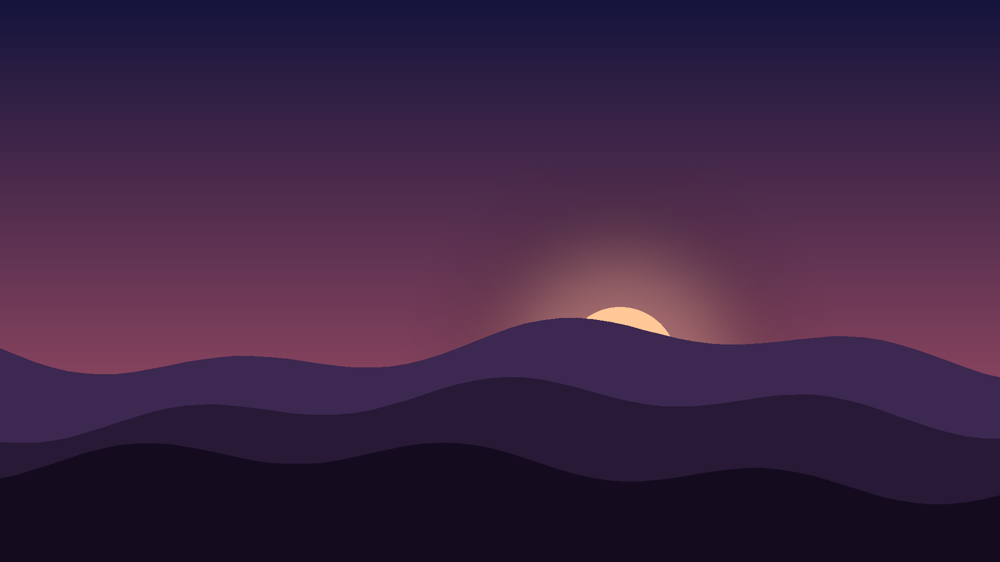

<!-- A short tour of what narrate renders. -->

```md
# narrate
Markdown in, narrated video out
```

(pause: 1.5)

---


This video was generated from a Markdown script, with no editing by hand.

Each paragraph of text becomes narration, and every scene lasts exactly as long as its voice-over.

---

```md
## How a script works

* scenes are separated by three dashes
* images and clips use Markdown image syntax
* stage directions sit in brackets
```

Text slides are fenced code blocks. Marked as Markdown, they get headings and bullet points.

---



(voice: Sarah)

Voices can change from one paragraph to the next.

(voice: George)

And pauses go anywhere… even mid-sentence.

(pause: 1)

That one was a full second.

---


(callout:
  cx: 640
  cy: 360
  size: 180
  alpha: 0.75)

Video clips play under the narration, and callouts pull the eye to one part of the frame.

---

(font-size: 40)

```python
def scene_length(audio, video, sync="freeze"):
    if sync == "match":
        return audio
    return max(audio, video)
```

Code slides are syntax highlighted. This one shows how long a scene with a video lasts.

---


(voice-speed: 0.9)

Speech by Kokoro or ElevenLabs, slides by Chromium, and video by ffmpeg.

(pause: 1)
