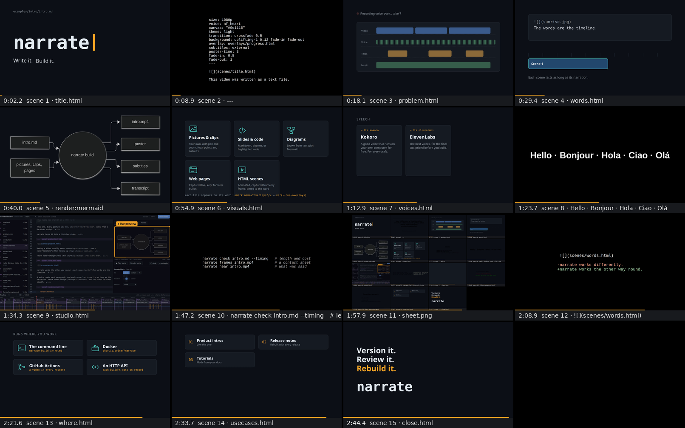

This video was written as a text file.

(pause: 1.5)

---

(font-size: 40)

```narrate
---
size: 1080p
voice: Narrator
canvas: "#0e1116"
theme: light
transition: crossfade 0.5
background: uplifting-1 0.12 fade-in fade-out
overlay: overlays/progress.html
subtitles: external
poster-time: 3
---


This video was written as a text file.
```

This one. Every picture you see, and every word you hear, comes from a Markdown script.

narrate turns it into a finished video.

---


Making a video usually means recording a voice-over. <mark name="timeline"/>Then lining up clips along a timeline.

<mark name="change"/>And when anything changes, you start over.

---


narrate works the other way round. <mark name="words"/>The words are the timeline.

A voice reads each paragraph, and each scene lasts exactly as long as its narration. <mark name="change"/>Change a sentence, and the video re-times itself.

---

```render:mermaid
---
background: "#0e1116"
---
flowchart LR
  S[intro.md] --> N((narrate build))
  M[pictures, clips, pages] --> N
  N --> V[intro.mp4]
  N --> P[poster]
  N --> T[subtitles]
  N --> X[transcript]
```

One command builds it. Out comes the video, a poster frame, subtitles, burned in or as files, and a transcript.

---


What's on screen is up to you.

<mark name="pictures"/>Your own pictures and clips, with pan and zoom. <mark name="slides"/>Slides and code. <mark name="diagrams"/>Diagrams, drawn from text.

<mark name="web"/>Live web pages. <mark name="scenes"/>Animated scenes, built in HTML, like this one. <mark name="overlays"/>And overlays laid on top, like the bar along the bottom.

Each tile appeared on its word. A mark in the script tells the page exactly when.

---


<mark name="kokoro"/>Draft with Kokoro, a free voice that runs on your own computer. <mark name="elevenlabs"/>Switch to ElevenLabs for the final cut.

<mark name="cache"/>Speech is cached, so an edit only re-records the paragraphs you changed, and costs next to nothing.

---

```
Hello · Bonjour · Hola · Ciao · Olá
```

There are dozens of voices, in several languages.

(voice: Narratrice)

(narration-language: fr)

Et pour la version française, il suffit de changer de voix.

---


Prefer to work visually? Open narrate studio.

<mark name="editor"/>Your script sits on the left. <mark name="preview"/>A live preview follows your cursor. <mark name="timeline"/>The timeline shows every scene. <mark name="inspector"/>And the inspector frames pictures and draws callouts.

---

(font-size: 40)

```sh
narrate check intro.md --timing   # length and cost
narrate frames intro.mp4          # a contact sheet
narrate hear intro.mp4            # what was said
```

It's built for automation, too. Check the length and the cost before you build. Look at a contact sheet of every scene.

And let speech-to-text confirm that each word came out right.

---



That's how an AI agent can make a video it can't watch.

This first draft was written that way, and this is its contact sheet.

---

(font-size: 46)

```diff
 

-narrate works differently.
+narrate works the other way round.
```

And because it's text, it works like code. Review a change in a pull request. Keep every version.

Rebuild it in CI when your product changes. The same script makes the same video, every time.

---


Run it from <mark name="cli"/>the command line, <mark name="docker"/>in Docker, or <mark name="actions"/>in GitHub Actions. <mark name="api"/>Or serve it over HTTP to your own tools, with what each build cost on record.

<mark name="narakeet"/>It even reads Narakeet's script format.

---


Use it for <mark name="intros"/>product intros. <mark name="releases"/>Release notes that rebuild with every release. <mark name="tutorials"/>Tutorials, made from your docs.

<mark name="training"/>Training that stays current. <mark name="languages"/>Any language. <mark name="agents"/>And explainers, made by agents.

---


Videos you can version, review and rebuild, like code.

That's narrate. Write it, build it, watch it.

(pause: 3.5)
